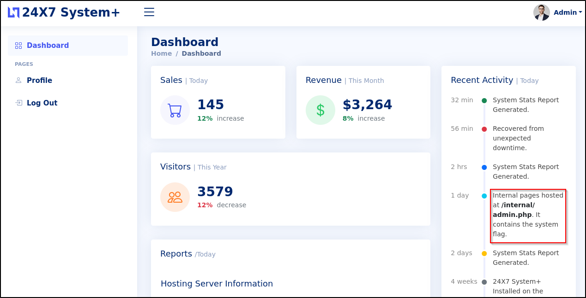
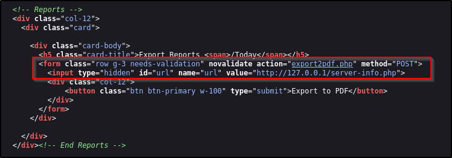

---
tags:
  - tryhackme
  - challenge
  - easy
  - offensive
  - linux
  - server-seide-request-forgery
---

# Surfer


**Platform:** TryHackMe  
**Type:** Challenge  
**Difficulty:** Easy  
**Link:** [Surfer](https://tryhackme.com/room/surfer)  

## Description
"Surf some internal webpages to find the flag!

Woah, check out this radical app! Isn't it narly dude? We've been surfing through some webpages and we want to get you on board too! They said this application has some functionality that is only available for internal usage -- but if you catch the right wave, you can probably find the sweet stuff!"

## Enumeration
### Port Scanning
```bash
ports=$(nmap -p- --min-rate=1000 TARGET_IP_ADDRESS | grep ^[0-9] | cut -d '/' -f 1 | tr '\n' ',' | sed s/,$//)
nmap -p$ports -A -T4 TARGET_IP_ADDRESS
```
```
Host is up (0.018s latency).

PORT   STATE SERVICE VERSION
22/tcp open  ssh     OpenSSH 8.2p1 Ubuntu 4ubuntu0.4 (Ubuntu Linux; protocol 2.0)
| ssh-hostkey: 
|   3072 54:f7:2e:eb:b2:77:eb:e5:0b:78:fe:36:cd:2c:0c:c9 (RSA)
|   256 df:b5:d0:04:91:fe:23:46:9b:cd:6c:3f:67:d8:75:bb (ECDSA)
|_  256 ad:16:06:7c:1d:c5:a2:f7:a2:b4:f4:ca:42:e4:9f:f3 (ED25519)
80/tcp open  http    Apache httpd 2.4.38 ((Debian))
| http-robots.txt: 1 disallowed entry 
|_/backup/chat.txt
| http-cookie-flags: 
|   /: 
|     PHPSESSID: 
|_      httponly flag not set
|_http-title: Did not follow redirect to /login.php
|_http-server-header: Apache/2.4.38 (Debian)
Warning: OSScan results may be unreliable because we could not find at least 1 open and 1 closed port
Device type: general purpose|phone|specialized
Running (JUST GUESSING): Linux 5.X|6.X|4.X (96%), Google Android 10.X|11.X|12.X (93%), Adtran embedded (92%)
OS CPE: cpe:/o:linux:linux_kernel:5 cpe:/o:linux:linux_kernel:6 cpe:/o:linux:linux_kernel:4 cpe:/o:google:android:10 cpe:/o:google:android:11 cpe:/o:google:android:12 cpe:/h:adtran:424rg
Aggressive OS guesses: Linux 5.14 - 6.8 (96%), Linux 4.15 - 5.19 (96%), Linux 4.15 (96%), Linux 5.4 - 5.15 (96%), Android 10 - 12 (Linux 4.14 - 4.19) (93%), Adtran 424RG FTTH gateway (92%), Android 10 - 11 (Linux 4.9 - 4.14) (92%), Android 12 (Linux 5.4) (92%), Android 9 - 11 (Linux 4.9 - 4.14) (92%), Linux 2.6.32 (92%)
No exact OS matches for host (test conditions non-ideal).
Network Distance: 3 hops
Service Info: OS: Linux; CPE: cpe:/o:linux:linux_kernel
```

### HTTP Enumeration (80)
```bash
`ffuf -u http://TARGET_IP_ADDRESS/FUZZ -w /usr/share/wordlists/seclists/Discovery/Web-Content/DirBuster-2007_directory-list-2.3-medium.txt -ic -c
```
**Notes**  
- `ffuf` reveals no hidden directories/pages  
- Navigating to home page reveals a login portal  
- Nothing interesting in the source code  
- No sitemap file  
- `robots.txt` reveals a disallowed entry  
**Action(s)**  
:white_check_mark: Navigate to disallowed `robots.txt` entry  


### Vulnerability Enumeration
```bash
searchsploit OpenSSH 8.2p1	# No results
searchsploit httpd 2.4.38	# Only result DoS
```

## Initial Foothold
**Action(s)**  
:white_check_mark: Use `admin:admin` credentials as suggested with login portal  
This is successful, finds further internal endpoint:  
  
Attempting to access results in custom error page:    
  
**Notes**  
Source code in dashboard reveals an export to PDF function that sends a `POST` request to display the contents of an internally hosted file:  
  
**Action(s)**  
:white_check_mark: Open Burp Suite  
:white_check_mark: Redirect browser traffic through Burp  
:white_check_mark: Navigate to generated PDF pagein browser  
:white_check_mark: Send request to Repeater in Burp  
:white_check_mark: Amend `POST` request value to reflect required internal endpoint (`http%3A%2F%2F127.0.0.1%2Finternal%2Fadmin.php`)  
:white_check_mark: Save Burp response as a PDF file (right-click > Save selected text to file)  
:white_check_mark: Open file
??? Success "Uncover the flag on the hidden application page."
	flag{6255c55660e292cf0116c053c9937810}

**Tools Used**  
`Burp Suite`

**Date completed:** 25/11/26  
**Date published:** 25/11/26